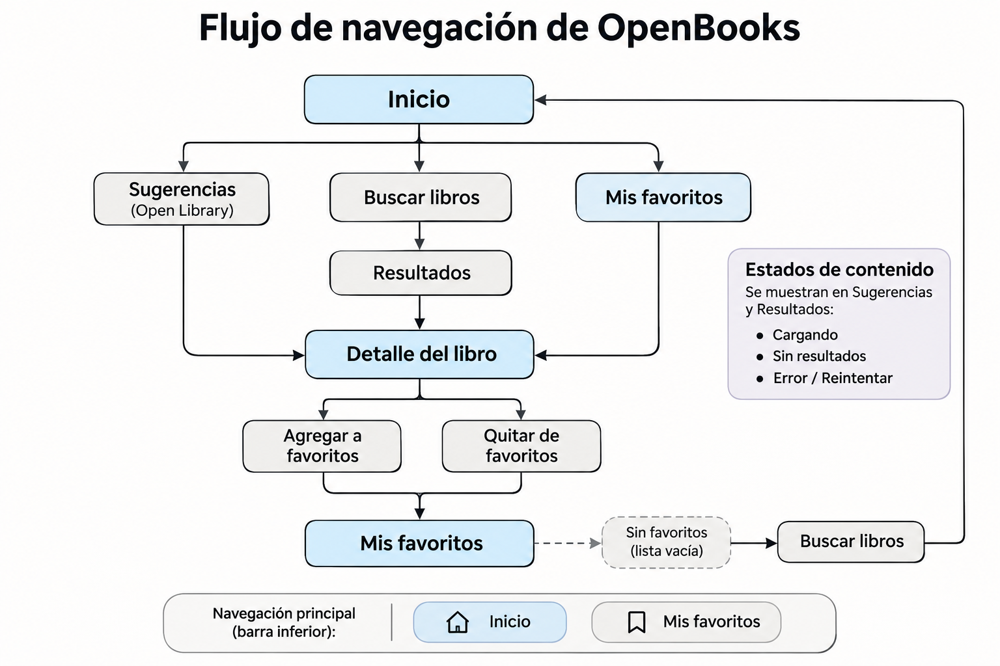

# Navegación y estado

OpenBooks utiliza `NavigationStack` para pasar de Inicio al buscador, a los resultados y al detalle de un libro. La barra inferior permite alternar entre **Inicio** y **Mis favoritos**.



## Recorridos principales

```text
Inicio → Sugerencias → Detalle del libro
Inicio → Buscar libros → Resultados → Detalle del libro
Inicio → Mis favoritos → Detalle del libro
Detalle → Agregar a favoritos → Mis favoritos
Detalle → Quitar de favoritos → Mis favoritos
Mis favoritos vacíos → Buscar libros
```

El destino **Detalle del libro** es una sola pantalla reutilizada por distintos recorridos. Después de guardar o quitar un libro, se abre Mis favoritos si la operación se completó correctamente.

## Pantallas

| Componente | Responsabilidad |
|---|---|
| `ContentView` | Coordina las rutas y el cambio entre Inicio y Mis favoritos. |
| `HomeView` | Muestra las sugerencias y el acceso a Buscar. |
| `SearchView` | Recibe el texto que escribe el usuario. |
| `SearchResultsView` | Presenta los resultados o el estado de la búsqueda. |
| `BookDetailView` | Presenta portada, información, descripción, temas y favoritos. |
| `MyBooksView` | Muestra los libros guardados o el estado vacío. |

## Rutas

`ContentView` mantiene un `path: [Int]` y configura destinos con `navigationDestination(for: Int.self)`. Los valores `-2` y `-1` representan Buscar y Resultados. Los índices de la colección de `BooksState` representan los libros abiertos en Detalle.

## Estado compartido

`BooksState` mantiene el arreglo de libros y sus indicadores `isSaved`. Los resultados de distintas consultas se combinan mediante el identificador de obra para evitar duplicados.

Hay dos instancias de `SearchViewModel`: una para sugerencias y otra para la búsqueda del usuario. Ambas usan `BookSearchService`, pero cada una conserva su propio estado y lista de índices.

`SearchViewState` distingue `loading`, `content`, `noResults` y `error`. Al comenzar una búsqueda, `prepareForSearch()` establece carga antes de mostrar Resultados para evitar presentar prematuramente el mensaje de ausencia de libros.

## Datos de favoritos

`BooksState` solicita el guardado o la eliminación mediante `FavoriteBooksStore`. `SavedBooksRepository` utiliza SwiftData para conservar los libros. Si ocurre un error al guardar, la interfaz informa del problema sin marcar el libro como guardado.

Si una descripción se descarga mientras está abierto Detalle, los datos se incorporan a la colección compartida mediante `applyWorkDetails` y se actualizan los metadatos almacenados del favorito cuando corresponde.

## Accesibilidad

Se utilizan etiquetas e identificadores de accesibilidad en los controles importantes, incluidos Buscar, los títulos y las acciones de favoritos. La aplicación también adapta los colores a la apariencia clara u oscura del sistema. Todavía falta verificar el recorrido completo con VoiceOver en un dispositivo físico.
