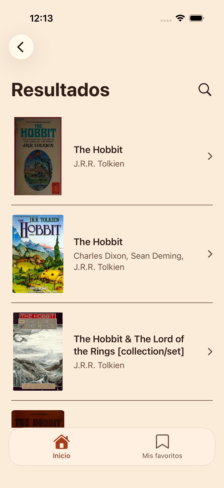
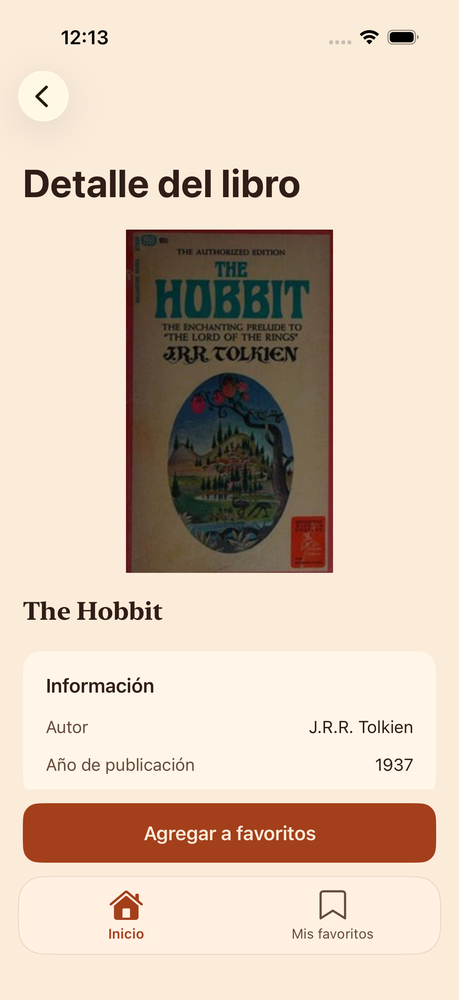
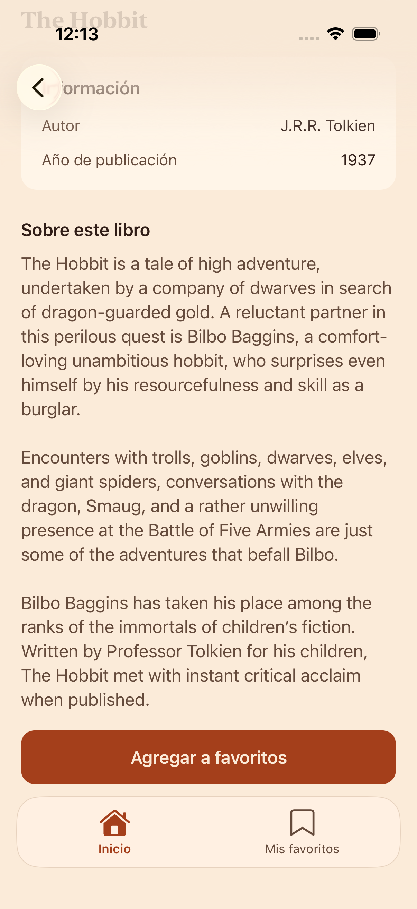
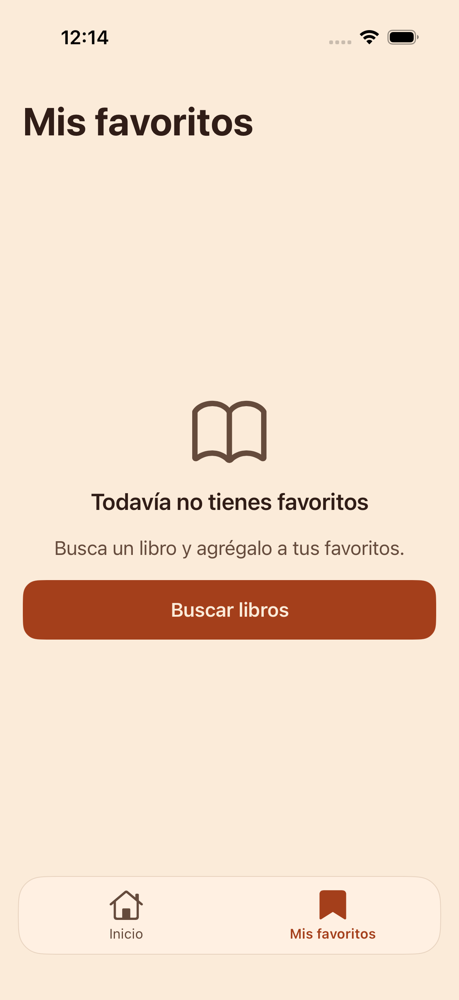
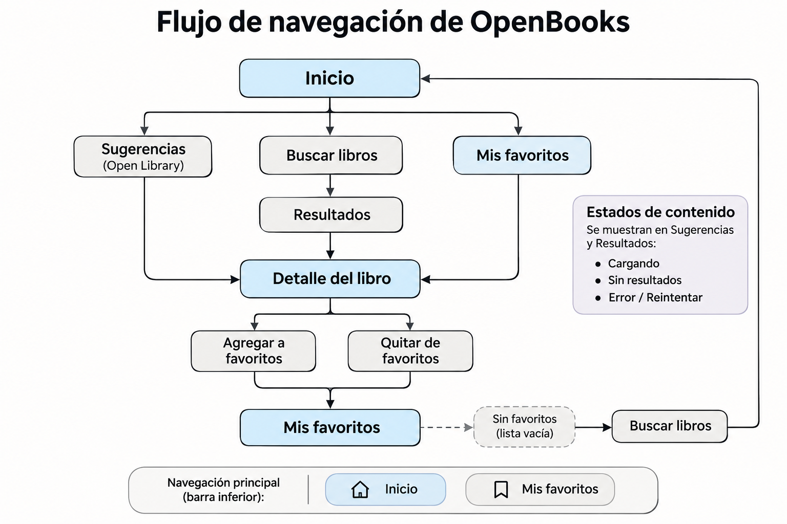

# OpenBooks

OpenBooks es una aplicación para iPhone que permite descubrir libros de Open Library, consultar sus datos y guardar una colección personal de favoritos. Su objetivo es facilitar la búsqueda de lecturas sin tener que organizar los títulos manualmente.

## Funciones principales

- Explorar sugerencias de libros reales desde la pantalla de Inicio.
- Buscar títulos utilizando el catálogo de Open Library.
- Abrir el detalle de cada obra y consultar autor, año de publicación, descripción y temas cuando estén disponibles.
- Guardar y quitar libros de **Mis favoritos**, con persistencia local mediante SwiftData.
- Mostrar estados de carga, error de conexión, búsqueda sin resultados y favoritos vacíos.
- Visualizar las portadas disponibles y un mensaje cuando Open Library no proporcione una portada.
- Utilizar la aplicación en modo claro y oscuro, con una interfaz adaptada a la apariencia de iOS.

Las sugerencias son resultados de la búsqueda temática `subject:fiction`, no una lista de popularidad ni recomendaciones personalizadas.

## Capturas de la aplicación

| Inicio | Resultados | Detalle |
|:--:|:--:|:--:|
|  |  |  |

| Descripción | Favorito guardado | Favoritos vacíos |
|:--:|:--:|:--:|
|  |  |  |

## Cómo funciona



Desde **Inicio** puedes abrir una sugerencia, buscar un libro o entrar a **Mis favoritos**. Las sugerencias, los resultados y los favoritos utilizan una misma pantalla de detalle. Después de agregar o quitar un libro, la aplicación muestra **Mis favoritos** con los cambios realizados.

Durante las consultas pueden aparecer los estados de carga, sin resultados y error, con una opción para volver a intentar la solicitud. Si no tienes favoritos, se muestra una invitación para buscar libros.

## Tecnologías

- **Swift y SwiftUI:** interfaz y navegación.
- **Observation (`@Observable`):** estado compartido de búsqueda y favoritos.
- **SwiftData:** almacenamiento local de los libros guardados.
- **Foundation, `URLSession` y `async/await`:** comunicación HTTPS con Open Library.
- **`Decodable` y `JSONDecoder`:** interpretación de las respuestas JSON.
- **XCTest:** pruebas unitarias de búsqueda, decodificación y persistencia.
- **Xcode:** ejecución en el simulador o en un iPhone.

## Requisitos

- Mac con **Xcode 15 o posterior** y un SDK compatible con iOS 17.
- Simulador de iPhone o dispositivo con **iOS 17.0 o posterior**.
- Conexión a Internet para descargar nuevos libros, portadas y datos de las obras.
- Para instalarla en un iPhone físico, configurar un equipo de firma válido en Xcode.

El proyecto no necesita servicios de pago, paquetes adicionales ni claves de acceso para Open Library.

## Instalación y ejecución

1. Clona este repositorio o descarga el código en ZIP.
2. Abre el archivo `OpenBooks.xcodeproj` en Xcode.
3. Selecciona el esquema **OpenBooks** y un simulador compatible.
4. Ejecuta con el botón **Run** o con **⌘R**.
5. En Inicio, selecciona una sugerencia o pulsa **Buscar libros** para escribir una consulta.
6. Abre un resultado para revisar sus datos y pulsa **Agregar a favoritos** si deseas guardarlo.
7. En **Mis favoritos**, abre el libro para consultar sus datos o quitarlo de la colección.

Para comprobar que el guardado funciona, cierra la aplicación y vuelve a abrirla **sin borrar los datos del simulador**. Los favoritos deberían continuar allí.

## Conexión con Open Library

La aplicación utiliza la [API pública de Open Library](https://openlibrary.org/developers/api). Estos son los recursos consultados:

| Función | Recurso |
|---|---|
| Búsqueda y sugerencias | `https://openlibrary.org/search.json` |
| Detalle de una obra | `https://openlibrary.org/works/{workID}.json` |
| Portada | `https://covers.openlibrary.org/b/id/{coverID}-M.jpg?default=false` |

En las búsquedas se envían `q`, `fields` y `limit=15`; la aplicación obtiene identificadores, títulos, autores, años y portadas disponibles. El detalle puede solicitar información adicional, como descripción y temas, desde el recurso de la obra.

**Configuración:** no hay que crear una clave API ni modificar archivos de credenciales. Las consultas están definidas en `OpenBooks/Services/OpenLibraryBookSearchService.swift`. Las portadas se descargan desde el componente correspondiente en `Views/Components/`.

Open Library puede no incluir el año, la portada o la descripción de un libro. Cuando falta el año, no aparece la fila «Año de publicación»; si falta la descripción, se muestra un mensaje. Las descripciones y los temas conservan el idioma recibido y pueden aparecer en inglés.

## Estructura del proyecto

```text
OpenBooks/
├── Assets.xcassets/     Imágenes y colores
├── Models/            Libros, favoritos y modelos de JSON
├── Services/          Búsqueda, detalle y almacenamiento local
├── ViewModels/        Estado compartido de las pantallas
├── Views/             Pantallas y componentes visuales
└── OpenBooksApp.swift  Configuración inicial de la aplicación
OpenBooksTests/         Pruebas unitarias
Docs/                   Documentación y capturas
```

Para conocer las responsabilidades de cada archivo, consulta:

- [Arquitectura y servicios](Docs/arquitectura-y-servicios.md)
- [Navegación y estado](Docs/navigation-and-state.md)
- [Organización MVVM](Docs/mvvm-proposal.md)
- [Pruebas y persistencia](Docs/pruebas-y-persistencia.md)

## Pruebas

El proyecto contiene pruebas unitarias con XCTest para revisar la conversión de respuestas, los estados de búsqueda y las operaciones de favoritos. Utilizan datos controlados y almacenamiento temporal en memoria, por lo que no modifican los favoritos de la aplicación ni requieren acceder al servicio remoto.

En Xcode, selecciona el esquema **OpenBooks** y ejecuta **Product → Test** (⌘U). También puedes ejecutar las pruebas desde una Mac mediante Terminal, reemplazando el simulador por uno que tengas instalado:

```bash
xcodebuild -project OpenBooks.xcodeproj -scheme OpenBooks \
  -destination 'platform=iOS Simulator,name=NOMBRE_DEL_SIMULADOR' \
  CODE_SIGNING_ALLOWED=NO test
```

El resultado de las pruebas depende de la versión y el entorno donde se ejecuten; la presencia de pruebas en el repositorio no significa que ya hayan pasado.

## Limitaciones conocidas

- El servicio externo puede responder lentamente, devolver información incompleta o no estar disponible. La aplicación permite volver a intentar la consulta, pero no puede garantizar una respuesta de Open Library.
- El contenido de las descripciones y temas depende del catálogo. No se traducen automáticamente.
- Los favoritos se almacenan localmente con SwiftData; no se sincronizan entre dispositivos.
- Las sugerencias recientes pueden recuperarse desde `UserDefaults`, mientras que las portadas se almacenan temporalmente en memoria y caché de archivos. Estos datos no sustituyen los favoritos guardados.
- No permite leer libros completos ni incluye recomendaciones personalizadas, compras o reseñas.
- Falta una revisión completa de accesibilidad con VoiceOver en un dispositivo físico.
- Si SwiftData no puede iniciar su contenedor de almacenamiento, la aplicación no dispone de una recuperación automática para ese fallo.

## Integrantes

- Romero Palacios Randy Rodrigo
- Villanueva García Emanuel
